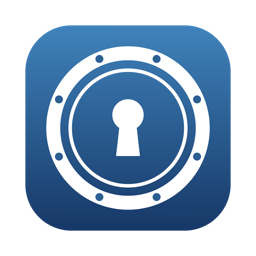

# Safe

Safe is a Mac app that keeps files encrypted and lets you use them from the Finder. "Encrypt with Safe" in a file's right-click menu turns `report.pdf` into `report.pdf.crypt` and deletes the original after checking the encrypted copy. A double-click on a `.crypt` file opens text in a small editor, and PDFs and pictures in a viewer; the decrypted content stays in the app's memory and is never written to the disk. Cmd-S saves with the password that opened the file and keeps the previous version as `NAME.crypt.bak`. "Export with Safe" writes a normal, unencrypted copy where you choose. Safe also makes and opens encrypted volumes (AES-256 sparse bundles), empty or from a folder. It has no network access. After 10 minutes without any input on the Mac, and when the Mac sleeps or locks, it hides the text and closes its volumes. It speaks English and German.

The files are in openssl's format, so they stay readable without Safe (see below). The repository also holds the older terminal tool, SafeDocker, at the end of this page.

## Install

Safe needs macOS 13 or later, on an Apple silicon or Intel Mac, and nothing else. Every way below puts it into the Applications folder of your home folder (`~/Applications`) and never asks for an administrator's password. Start Safe once afterwards, so that the Finder learns its right-click menu items; the Terminal and the agent do that for you.

### 1. The installer

Download [Safe.pkg](https://github.com/fherwig/Safe/releases/latest/download/Safe.pkg) from the [latest release](https://github.com/fherwig/Safe/releases/latest) and open it. It installs for you only, into `~/Applications`. Installing over an older version is fine; quit Safe first. Then open Safe once from your Applications folder.

### 2. The Terminal

Paste this line into the Terminal:

    curl -fsSL https://raw.githubusercontent.com/fherwig/Safe/main/install-safe.sh | bash

[install-safe.sh](install-safe.sh) checks the Mac, downloads `Safe.zip` and `SHA256SUMS` from the latest release, refuses to go on if the SHA-256 checksum does not match, checks the app's signature and runs its self-test, and only then installs it, replacing an older version. If Safe is running, it asks you to quit it first. It also updates (run it again) and uninstalls:

    curl -fsSL https://raw.githubusercontent.com/fherwig/Safe/main/install-safe.sh | bash -s -- --uninstall

Uninstalling removes the app and keeps your encrypted files, your volumes and Safe's list of them; `--uninstall --remove-data` removes the list and the settings as well. `--help` shows all options.

### 3. An AI agent

Ask an AI system administration agent (Claude Code, Codex and the like) to install Safe by following [INSTALL-AGENT.md](INSTALL-AGENT.md). It checks the Mac with [app/scripts/agent-check.sh](app/scripts/agent-check.sh), installs the release, checks it and tells you how to use it. It never asks for, sees or types your passwords, and never touches your encrypted files or volumes. The same file tells it how to update and remove Safe.

### 4. Build it yourself

Building needs Apple's Command Line Tools (`xcode-select --install`) and macOS 14.5 or later. In a clone of this repository:

    bash install-safe.sh --from-source

or, step by step, `app/scripts/build-app.sh --release`, which puts a checked `Safe.app` into `app/dist/`. Section 4 of INSTALL-AGENT.md has the details.

### The app is not signed by Apple

Safe has no Developer ID and is not notarised; it is signed ad hoc. So macOS refuses to open the installer the first time and says that Apple could not check it for malicious software. On macOS 15 (Sequoia) and later, click Done, open System Settings > Privacy & Security, scroll down to the line that says the installer was blocked, click Open Anyway, and confirm with your password. On macOS 13 and 14, right-click the installer, choose Open, and confirm. If macOS then also refuses Safe itself, allow it the same way. The Terminal install does not meet this question: curl, unlike a browser, does not mark its downloads as coming from the internet, and the checksum and the signature check take its place.

## How it works

Help > Safe Help (Command-?) in the app explains how Safe works and why, in plain English and in German, and the "?" buttons in its windows open the matching section. [docs/requirements.md](docs/requirements.md) has the requirements, [docs/format.md](docs/format.md) the file format, and [docs/safe-app/](docs/safe-app/) the building plan, the design decisions, the architecture as built and the acceptance checklist.

Safe encrypts with AES-256-CBC and a key made from the password with PBKDF2 (SHA-512, 100,000 iterations), as `openssl enc` does. Every time it starts, it switches off its own network access and checks itself against reference files made by several programs. Nothing it decrypts is written to the disk. Nobody can recover a forgotten password.

## Your files stay readable without Safe

A `.crypt` file opens on any Mac with macOS's own openssl, which asks for the password:

    openssl enc -d -aes-256-cbc -md sha512 -pbkdf2 -iter 100000 -in FILE.crypt -out FILE

[tools/safe-decrypt.py](tools/README.md) reads every format Safe knows, old ones included, and needs nothing but Python 3. A volume is a standard Apple disk image: a double-click in the Finder opens it with its password.

## The terminal tool: SafeDocker

SafeDocker, the older tool in this repository, keeps a text file of passwords encrypted twice. The file, `safe.txt.crypt`, is encrypted with openssl and lives inside an encrypted macOS disk image. You read and edit it in a Docker container that has no network. When you leave, the plain text is gone, the container is removed and the disk image is unmounted. Files encrypted by Safe open with its `crypt.sh`, and the other way round.

### What you need

- macOS with Docker Desktop
- an encrypted disk image for the safe. To make one:

      hdiutil create -size 100m -fs APFS -encryption AES-256 -volname safe safe.dmg

### Install

    ./install.sh

asks where your disk image lives, and which app keeps its folder in sync, if any. It saves the answers in `safe.conf`, which git ignores, and builds the Docker image `fherwig/safe:22.0` if it is missing. `docker pull fherwig/safe:22.0` gets a ready-made image from Docker Hub instead, for Intel and Apple-silicon Macs.

### Use

    ./safe_load.sh

asks for the password of the disk image, mounts it at `/Volumes/safe` and opens a shell in the container, with the safe as the home folder. There, `bd` decrypts `safe.txt.crypt`, opens it in emacs, encrypts it again if you changed it, and removes the plain text. Leave the container with `exit`; `safe_load.sh` then removes the container and unmounts the safe.

The first time, write `safe.txt` in the container (`emacs safe.txt`) and encrypt it with `crypt.sh -e -r safe.txt`. [safe_tools/README.md](safe_tools/README.md) describes `bd` and `crypt.sh`.

Docker Desktop keeps the files of the safe cached in its Linux VM. To clear that cache, `safe_load.sh` runs a privileged container for a second, before and after the session. That container has no network and no access to the safe.

## Licence

Copyright © 2026 Falk Herwig and contributors.

Safe and SafeDocker are free software: you can redistribute them and/or modify them under the terms of the GNU General Public License as published by the Free Software Foundation, either version 3 of the License, or (at your option) any later version. They are distributed in the hope that they will be useful, but WITHOUT ANY WARRANTY; without even the implied warranty of MERCHANTABILITY or FITNESS FOR A PARTICULAR PURPOSE. See [LICENSE](LICENSE) for the full text. A copy of the licence ships inside the app, in `Safe.app/Contents/Resources/LICENSE`.

One exception: [safe_tools/crypt.sh](safe_tools/crypt.sh) grew from a free script by other authors and keeps their terms, which its header states; the GPL covers only the changes made here.
